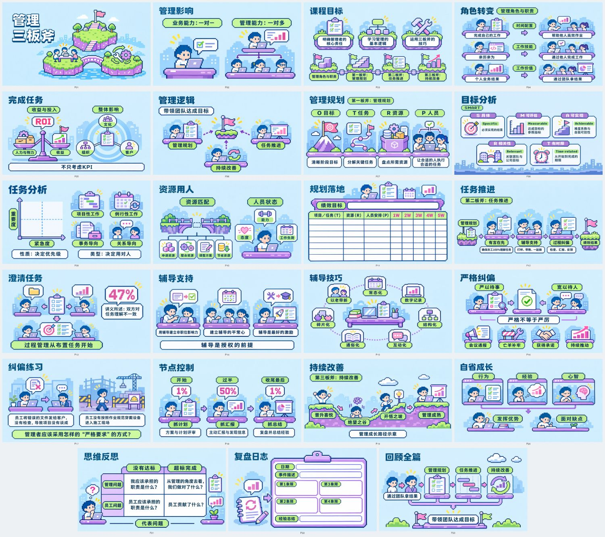
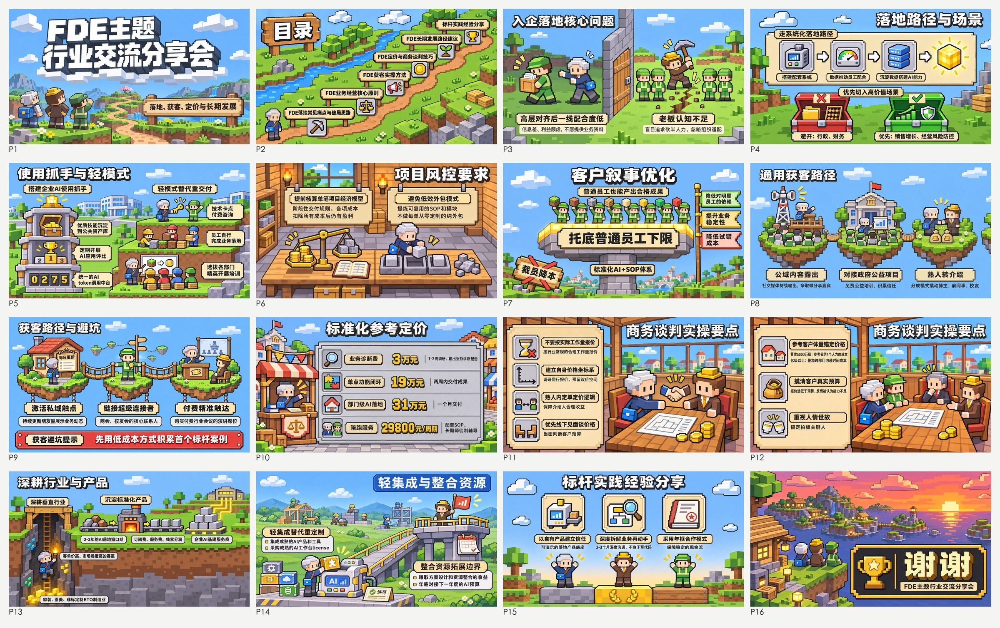

# 摸鱼PPT（moyu-ppt）

一图一页，AI 导演整套视觉。

把文章、演讲稿和路演材料变成有统一字体与视觉系统的图像版 PPT。支持只找灵感、只定风格字体、只做方案、整套生成与指定页修订；整套完成后，可以把喜欢的风格收藏为本地模板，下次按名字复用。

Moyu PPT (`moyu-ppt`) is an agent skill that turns articles, talks and pitch material into image-based PowerPoint decks with one consistent visual system: inspiration search, typography, per-slide spatial briefs, image generation and PPTX assembly.

作者：**摸鱼小李**（公众号「摸鱼小李」，更新和用法都发在那里）。开源；技能本身不可拿去商业化，用它做 PPT 不受限，见[协议](#协议)。

## 效果



示例一：一套 23 页的知识型课件，像素风。每一页都是一张图，标题和正文画在图里。



示例二：一套 16 页的分享，方块像素游戏风格。封面、目录、结尾各有各的构图，内容页一页一个场景。

## 你可以直接这样说

- “把这篇公众号文章做成一套PPT，参考要有不同方向。”
- “只给这套路演做空间定位图，先不要生图。”
- “保持品牌黑白，找几种适合内容页的排版。”
- “先给整套PPT定标题和正文字体，需要时生成字形参考。”
- “修改上一套图像版PPT的第3页，其他页沿用。”
- “做完后把这套风格存成‘暖白编辑风’，下次继续用。”
- “用上次收藏的‘暖白编辑风’做这份新材料。”
- “列出我保存过的PPT模板。”

原生可编辑PPTX、HTML演示与独立知识卡片有各自的技能入口。本技能交付图片满铺的PPTX，文字在图内。

## 一套PPT怎么走

默认会在五个地方停下来请你确认：

1. **需求**：技能先读完你的材料，写一份内容骨架给你看：这是知识型还是演讲型，讲者从头到尾在讲什么，每一节的要点和原文依据，几档页数各舍掉哪些内容。然后确认页数、画幅、受众/用途、图文融合占比（演讲型建议视觉主导 80/20，知识型建议 70/30 上下；大部分页按这个比例做，个别页最多低 5 点；也可以按内容逐页定）、标题排版（统一版式：每页标题在同一位置、一样大，适合汇报和课件；自由构图：标题跟着每页的画面走，更大胆，适合分享和画面感强的风格），以及你希望观众感到什么、喜欢或排斥什么。可以回复“按这组建议”。
2. **文案**：技能把全篇每页要上屏的文字写成一份文案稿，一次给你看：每页的标题和每一行字，哪些是原文、哪些是压缩、哪些是新增。原文没有的总结句和口号不加；知识型里引语、金句和人物署名默认不放，你说要留才留。你在这里改字；确认之后，页面上只会出现这份文案稿里的字。
3. **方向**：先看你本地风格库里存过的参考图；要搜时，你点了名的风格只搜和它有关的：这个风格的演示稿和版式，以及它自己的元素（界面、图标、场景、纹理）。通用的商务版式和相近的风格都不搜，你说了才搜。结果做成分组、带编号的高清原图图库，不替你删图。技能看过原图后会给两三套搭配建议，每套拼成一张整版给你看，你可以照着选，也可以自己从两类里各挑一两张，觉得不错的其他几张可以存进风格库，下次直接用。技能再把你挑的版式和画风搭配成方向，连同中文字体搭配给你确认。
4. **大纲 + 样页**：全篇大纲、覆盖表（原文的每一节去了哪一页，哪些合并、哪些不上屏）和 1–3 张真实样页。这一步主要看视觉，确认后才生成其余页面。
5. **收藏**：交付后问一次要不要存成模板。

想省事可以直接说“页数和风格你来定，直接做”，技能会记下授权范围并减少询问；样页自检和文件检查照常进行。

## 不用技能也能用：元提示词

[meta-prompt/ppt-meta-prompt.md](meta-prompt/ppt-meta-prompt.md) 是从本技能提炼的一份独立提示词：发给任意对话型 AI，它会根据内容和你的描述现场设计风格（不用固定风格清单），写出全篇风格锁定块和每页给绘图模型的提示词，不需要检索参考图。适合没有运行环境、或只想要提示词的场合；需要检索参考、门禁和 PPTX 装配时用本技能。

## 安装

1. 把整个文件夹放进你所用平台的技能目录。例如 Codex 是 `~/.codex/skills/moyu-ppt`，Claude Code 是 `~/.claude/skills/moyu-ppt`；豆包工作、WorkBuddy 按各自的技能导入方式添加这个文件夹。
2. 安装依赖（Python 3.9+）：

```bash
python3 -m pip install -r requirements.txt
```

3. 对助手说“帮我做一套 PPT”，第一次会先做下面的首次配置。

## 首次配置

第一次使用时，技能会问两件事，之后不再问：

1. **你在哪里用**：豆包工作、WorkBuddy、Codex，还是别的。

| 平台 | 生图 |
|---|---|
| 豆包工作 | 直接用豆包工作自带的图像模型，不用配置 |
| Codex | 直接用 Codex 自带的图像工具，不用配置 |
| WorkBuddy、Claude Code 等 | 有内置生图工具就用；没有就配一个外部生图模型 |

任何平台都可以改用自己的生图模型。脚本内置三个渠道：ZenMux（gpt-image 系列）、火山方舟（Seedream 系列）、APIYI 中转（gpt-image 系列），模型名可以自己换。

2. **灵感检索的 key**：打开 https://app.scrapecreators.com/ 注册并复制 API Key，发给助手即可（检索按请求计费，费用以官网为准）。不想配也能用，只是没有 Pinterest 检索，灵感只来自你自己给的参考图。

完整说明、命令和自己配置生图模型的方法见[首次配置文档](references/setup.md)。想自己动手配：

```bash
python3 scripts/configure.py status
```

设置和密钥保存在你自己的配置目录（默认 `~/.config/moyu-ppt/`），不在技能目录里，升级技能不会丢。密钥文件权限为 600，脚本不会把密钥写进作品、日志或回复。外部生图和检索都是付费请求；dry-run 不读密钥、不联网。

## 本地测试

```bash
python3 -m unittest discover -s tests
```

## 状态与恢复

每套作品建在你自己的项目目录下的 `decks/{名称}/`，不放在技能目录里（技能升级不会动到作品）。决定都记在 `deck-state.json`，由技能目录里的 `scripts/deck_state.py` 写入：

```bash
python3 /path/to/moyu-ppt/scripts/deck_state.py status --state decks/my-deck/deck-state.json
```

`status` 会列出已确认的决定、各门禁是否通过、下一步缺什么，以及确认后被改动过的文件。页数、字体方案、样页等确认过的内容一旦改变，对应确认会自动失效，需要重新确认。命令一览见 [workflow-gates](references/workflow-gates.md)。

## 输出

```text
decks/my-deck/
  deck-state.json
  content-map.md
  page-copy.md
  inspiration-plan.json
  visual-proposal.md
  design-plans.md
  assets/style-configs/
  assets/typography/
  assets/brand/
  briefs/
  images/
  manifest-anchors.json
  manifest-pages.json
  deck-constants.txt
  run-state.json
  overview.png
  quality-report.json
  my-deck.pptx
```

局部任务只输出对应阶段的产物。命令见[执行手册](references/generation-pipeline.md)。

## 模板收藏与复用

整套PPT和必要检查完成后，会问一次是否把选中的设计存为模板；提前同意或拒绝过就照办，没有回复不会保存，也不会反复追问。可以改名收藏，或只收藏部分风格/字体/版式参考。

默认库位于 `~/.local/share/moyu-ppt/templates`（设置 XDG_DATA_HOME 时用其下同名目录）。模板带独立图片副本，原项目移动或升级技能都不影响收藏；同名模板自动增加版本。保存的是设计规则和选定参考，下一套仍按新素材决定文案、数据、品牌和页序。详见[模板库说明](references/template-library.md)。

## 常见问题

| 问题 | 处理 |
|---|---|
| 参考看起来都一样 | 检查允许探索的维度、模板家族重复和页型覆盖，针对缺口补搜 |
| 参考很土、方向不对 | 回查搜索前的整体风格回答；去掉没有依据的颜色/材质假设，分别找设计案例与图像补充 |
| 字体样张带走整页风格 | T 只指定文字角色，清除样张背景/布局影响；正文保持独立规范 |
| 拆分报“和已确认的文案稿不一致” | 方案里的字照抄文案稿；要改字，先改 `page-copy.md` 并重新确认 |
| 方案拆分失败 | 按报错补常量/清单、修页号/族锚；把手写图号改成稳定 ID |
| 标题或数据错字 | 修改对应页，target 指向待修图，核对原文简繁、标点与单位 |
| 重跑提示 unknown | 先核对服务状态；确需新请求时才用 --force |
| 结构通过但 review pending | 完成必要视觉复核，记录当前图片 hash 对应的 review-notes |
| 门禁报缺决定或产物 | 运行 `deck_state.py status` 看缺什么，从真实对话补齐 |
| 升级技能后继续做之前的作品 | `status` 会提示状态里记录的版本与当前不同；重新读取 SKILL.md 与相应 references，已导出的包重新预检 |
| 缺 Python/Pillow | 使用平台已有运行时，或按 requirements 安装 |

## 证据边界

本地测试、语义路由探针、实际字体小样和视觉 A/B 是不同等级的证据，分级规则见[检查与证据](references/quality-and-evaluation.md)。

## 作者与联系

摸鱼小李。公众号「摸鱼小李」：新版本、用法和案例会先发在那里，欢迎关注。

有问题、想交流或谈合作，微信扫码加我（请备注 moyu-ppt）：


## 协议

CC BY-NC-SA 4.0 © 2026 摸鱼小李

本项目开源，但技能本身不允许商业化。采用 CC BY-NC-SA 4.0（署名-非商业性使用-相同方式共享）协议，要点：

1. **必须署名**：保留版权与署名声明，注明出处。
2. **技能本身不允许商业化**：不得售卖、付费分发本技能或它的修改版本，不得做成收费产品或收费服务，不得集成进商业产品。
3. **衍生品必须同样开放**：任何修改版本、Fork、二次分发，必须以同一协议公开发布。
4. **不允许闭源、专有化**。

**用它做 PPT 不受限**：给自己、公司或客户做 PPT 都可以，工作和商业场合也可以，做出来的 PPT 归你自己。这是作者在协议之外额外给的许可。个人学习和非商业分享同样不受限制。

完整条款见 [LICENSE](LICENSE)。

🤝 商用授权与共创：AI Agent 厂商、模型厂商想把摸鱼PPT 集成进产品，或基于它做深度共建，很欢迎，请先联系摸鱼小李取得授权。
